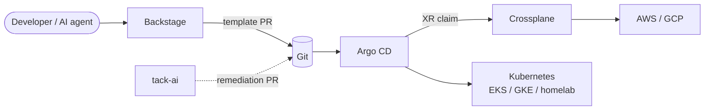

# Skylar Houghton

Platform engineer. I build internal developer platforms with **Argo CD**, **Crossplane**, **KubeVela**, and **Backstage**.

## Skylab

A homelab-based internal developer platform, split across five public repos as one story. Humans and agents only ever write to Git; Argo CD is the single path into the clusters.

### Repos

| Repo | Role |
| --- | --- |
| [skylab-gitops](https://github.com/SkylarHoughtonGithub/skylab-gitops) | **Delivery** — everything Argo CD syncs: wrapper charts, cluster config, workloads. Sync waves with a restored Application health check; cluster-as-data instead of path-based environments. |
| [skylab-terraform](https://github.com/SkylarHoughtonGithub/skylab-terraform) | **Foundations** — AWS + GCP: OIDC, workload identity, buckets, Roles Anywhere with step-ca as the trust anchor. |
| [skylab-crossplane](https://github.com/SkylarHoughtonGithub/skylab-crossplane) | **Infrastructure API** — cloud-agnostic XRDs (`KubernetesCluster`, `Network`, `Postgres`, `Bucket`) with AWS and GCP compositions. Published as an OCI package. |
| [skylab-backstage](https://github.com/SkylarHoughtonGithub/skylab-backstage) | **Front door** — catalog, golden-path templates, MCP actions for AI clients. Writes scaffolder output to Gitea; never touches clusters directly. |
| [tack-ai](https://github.com/SkylarHoughtonGithub/tack-ai) | **Remediation** — policy-governed coding agent with a tamper-evident audit trail. Proposes fixes as pull requests, behind Cedar and OPA. |

### More

- Case studies, standout decisions, and the resume: **[skylab-portfolio](https://github.com/SkylarHoughtonGithub/skylab-portfolio)**
- Reach me through my GitHub profile.
